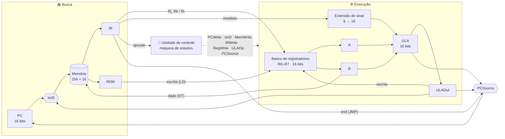
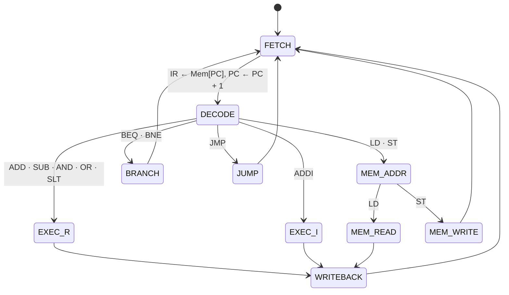
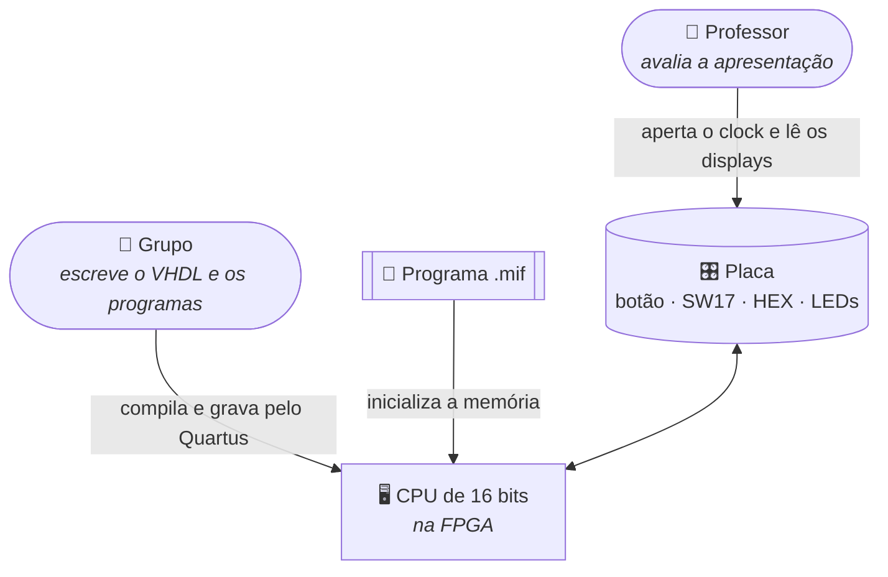
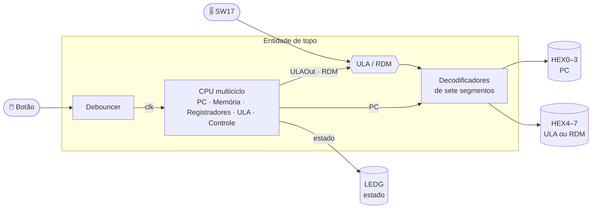

<div align="center">

# ProjetoPraticoVHDL

**Uma CPU multiciclo de 16 bits em VHDL, do opcode ao display de sete segmentos.**

Do `.mif` carregado na memória ao resultado na ULA, da busca à escrita no registrador: a CPU executa cada instrução passo a passo e mostra cada passo na FPGA.

<br />


<br />


</div>

---

## Project Overview

O **ProjetoPraticoVHDL** é uma **CPU multiciclo de 16 bits** escrita em VHDL para o laboratório de **Arquitetura de Sistemas Computacionais** (218040P). Ela busca, decodifica e executa 11 instruções (aritméticas, lógicas, de memória e de desvio), lê o programa de uma memória inicializada por `.mif` e roda na FPGA com **clock manual**, para acompanhar a execução estado por estado.

### ✨ O que ela faz

| | Recurso | Em uma frase |
|:-:|---|---|
| 📍 | **Contador de programa** | PC de 16 bits com reset assíncrono, que só muda quando a unidade de controle liga o `PCWrite`. |
| 🧠 | **Memória unificada** | Instruções e dados na mesma memória de 256 palavras de 16 bits, com leitura e escrita síncronas. |
| 🗃️ | **Banco de registradores** | 8 registradores de 16 bits (R0–R7), endereçados por 3 bits, com duas leituras e uma escrita síncronas. |
| 🧮 | **ULA de 16 bits** | AND, OR, soma, subtração, SLT e NOR em complemento de dois, com **flag de zero** para os desvios. |
| 🔁 | **Unidade de controle multiciclo** | Uma máquina de estados (busca, decodificação, execução, memória, escrita) que gera todos os sinais do caminho de dados. |
| ↪️ | **Desvios e salto** | BEQ e BNE relativos ao PC, JMP absoluto com endereço de 12 bits. |
| 🔢 | **Displays de sete segmentos** | PC em hexadecimal nos HEX0–3; saída da ULA ou RDM nos HEX4–7, escolhidos pela chave **SW17**. |
| 💡 | **Estado visível** | Os LEDs verdes indicam em qual estado a unidade de controle está. |
| 🖱️ | **Clock manual com debouncer** | Cada aperto do botão vira exatamente um pulso de clock. |

---

## Table of Contents

- [Project Overview](#project-overview)
- [Architecture](#architecture)
- [C4 Model Architecture](#c4-model-architecture)
- [Repository Structure](#repository-structure)
- [Dependencies and Integration](#dependencies-and-integration)
- [Component Interfaces](#component-interfaces)
- [Development Notes](#development-notes)
- [Known Issues and Limitations](#known-issues-and-limitations)
- [Additional Documentation](#additional-documentation)
- [Equipe](#equipe)

---

## Architecture

### Visão geral

Uma CPU **multiciclo**: cada instrução leva de 3 a 5 ciclos, e uma única memória, uma única ULA e registradores intermediários (IR, RDM, A, B, ULAOut) são reaproveitados entre os ciclos. A unidade de controle decide, a cada estado, quem escreve e para onde cada multiplexador aponta.



<sub>Visão simplificada. O diagrama completo do caminho de dados, com todos os multiplexadores e sinais, fica no documento de especificação.</sub>

### 🧰 Stack

| Camada | Tecnologia | Para quê |
|---|---|---|
| Descrição de hardware | **VHDL** (`IEEE.STD_LOGIC_1164`, `IEEE.NUMERIC_STD`) | Todos os componentes da CPU |
| Síntese e gravação | **Intel Quartus Prime** | Compilar, atribuir pinos e gravar na placa |
| Placa | **Cyclone IV E** (DE2-115) | HEX0–7, SW17, LEDs verdes e botões |
| Simulação | **GHDL** + **GTKWave**, ou **ModelSim** | Testbenches e formas de onda |
| Programas | **`.mif`** (Memory Initialization File) | Carregar o programa de teste na memória |

### 📜 Conjunto de instruções

| Instrução | Significado | Tipo | Descrição |
|---|---|:-:|---|
| `ADD Ri, Rj, Rk` | `Ri ← Rj + Rk` | R | Soma entre dois registradores |
| `SUB Ri, Rj, Rk` | `Ri ← Rj − Rk` | R | Subtração entre dois registradores |
| `AND Ri, Rj, Rk` | `Ri ← Rj AND Rk` | R | AND bit a bit |
| `OR Ri, Rj, Rk` | `Ri ← Rj OR Rk` | R | OR bit a bit |
| `SLT Ri, Rj, Rk` | `Ri ← 1` se `Rj < Rk`, senão `0` | R | Set se menor que |
| `ADDI Ri, Rj, imm` | `Ri ← Rj + imm` | I | Soma com imediato |
| `LD Ri, Rj, imm` | `Ri ← Mem[Rj + imm]` | I | Load |
| `ST Ri, Rj, imm` | `Mem[Rj + imm] ← Ri` | I | Store |
| `BEQ Ri, Rj, imm` | `PC ← PC + imm` se `Ri = Rj` | I | Desvio se igual |
| `BNE Ri, Rj, imm` | `PC ← PC + imm` se `Ri ≠ Rj` | I | Desvio se diferente |
| `JMP end` | `PC ← end` | J | Salto incondicional |

```text
Tipo R   | opcode (4) | Ri (3) | Rj (3) | Rk (3) | não usado (3) |
          15       12   11    9   8     6   5     3   2           0

Tipo I   | opcode (4) | Ri (3) | Rj (3) |     imediato (6)      |
          15       12   11    9   8     6   5                     0

Tipo J   | opcode (4) |                 end (12)                 |
          15       12   11                                        0
```

- **Imediato** de 6 bits em complemento de dois (−32 a +31), estendido com sinal para 16 bits antes de ir à ULA.
- **`end`** de 12 bits: o formato permite 4096 endereços, mas a memória atual tem 256 palavras.

### 🧮 Operações da ULA

| `ula_control` | Operação | Usada por |
|:-:|---|---|
| `000` | `A AND B` | AND |
| `001` | `A OR B` | OR |
| `010` | `A + B` | ADD, ADDI, LD, ST |
| `100` | `A − B` | SUB, BEQ, BNE |
| `110` | `1` se `A < B` (com sinal), senão `0` | SLT |
| `111` | `NOT (A OR B)` | nenhuma instrução por enquanto |

A saída `zero` vale `1` quando o resultado é `0x0000`: é ela que decide o BEQ e o BNE depois da subtração.

### 🔁 Unidade de controle

Toda instrução passa por **FETCH** e **DECODE**, e depois segue o ramo do seu tipo. Os LEDs verdes mostram o estado atual.



| Estado | O que acontece | Usado por |
|---|---|---|
| **FETCH** | `IR ← Mem[PC]`, `PC ← PC + 1` | todas |
| **DECODE** | Lê os registradores para A e B; calcula o alvo do desvio | todas |
| **EXEC_R** | ULA opera A e B conforme o opcode | ADD, SUB, AND, OR, SLT |
| **EXEC_I** | ULA soma A e o imediato estendido | ADDI |
| **MEM_ADDR** | ULA calcula `Rj + imm` | LD, ST |
| **MEM_READ** | `RDM ← Mem[ULAOut]` | LD |
| **MEM_WRITE** | `Mem[ULAOut] ← Ri` | ST |
| **WRITEBACK** | `Ri ← ULAOut` ou `Ri ← RDM` | R, ADDI, LD |
| **BRANCH** | Subtrai `Ri − Rj`; atualiza o PC conforme a flag `zero` | BEQ, BNE |
| **JUMP** | `PC ← end` | JMP |

### 🧩 Padrões de projeto

- **Tudo síncrono na borda de subida.** Memória, registradores e PC atualizam em `rising_edge(clk)`; a ULA é o único bloco combinacional.
- **Escrita só com habilitação.** Nada é gravado sem o sinal da unidade de controle (`PCWrite`, `memWrite`, `reg_write`).
- **Aritmética com sinal.** A ULA usa `signed` para soma, subtração e SLT, então o imediato negativo funciona sem caso especial.

---

## C4 Model Architecture

<details>
<summary><b>Nível 1 — Contexto</b></summary>



</details>

<details>
<summary><b>Nível 2 — Contêineres</b></summary>



</details>

---

## Repository Structure

```text
ProjetoPraticoVHDL/
├── multicycle/
│   ├── pc.vhd                     # contador de programa (branch 6-pc)
│   └── mem.vhd                    # memória 256 × 16 bits (branch 2-mem-ram)
├── banco_registradores/
│   └── banco_registradores.vhd    # 8 registradores de 16 bits (branch banco_reg)
├── ula/
│   └── ula.vhd                    # ULA de 16 bits com flag de zero (branch ula)
├── testbench/
│   └── mem_tb.vhd                 # testbench da memória (branch 2-mem-ram)
├── .gitignore                     # artefatos do Quartus, ModelSim, GHDL e Vivado
└── README.md
```

<sub>A árvore mostra como fica depois de juntar as branches na `main`. Hoje a `main` tem só o `.gitignore` e o README.</sub>

| Arquivo-chave | Papel |
|---|---|
| `multicycle/pc.vhd` | Guarda o endereço da próxima instrução |
| `multicycle/mem.vhd` | Memória única de instruções e dados |
| `banco_registradores/banco_registradores.vhd` | R0–R7, duas leituras e uma escrita |
| `ula/ula.vhd` | Operações aritméticas e lógicas, e a flag `zero` dos desvios |
| `testbench/mem_tb.vhd` | Escreve `0xABCD` no endereço 4 e lê de volta |

---

## Dependencies and Integration

| Ferramenta | Usada para | Obrigatória? | Observação |
|---|---|:-:|---|
| **Intel Quartus Prime** | Síntese, pinos e gravação | ✅ | Também gera e edita os `.mif` |
| **Placa com Cyclone IV E** (DE2-115) | Rodar a CPU | ✅ | Precisa de HEX0–7, SW17 e LEDs verdes |
| **ModelSim** | Simular pelo Quartus | ➖ | Opção do laboratório |

Não há bibliotecas externas além das padrão do IEEE.

---

## Component Interfaces

| Componente | Entidade | Entradas | Saídas |
|---|---|---|---|
| PC | `pc` | `clk`, `rst`, `PCWrite`, `PC_next[16]` | `PC_out[16]` |
| Memória | `Mem` | `clk`, `memWrite`, `memRead`, `address[16]`, `writeData[16]` | `MemData[16]` |
| Banco de registradores | `BancoRegistradores` | `clk`, `rst`, `reg_write`, `read_reg1[3]`, `read_reg2[3]`, `write_reg[3]`, `write_data[16]` | `read_data1[16]`, `read_data2[16]` |
| ULA | `ula` | `A[16]`, `B[16]`, `ula_control[3]` | `saida[16]`, `zero` |

**Comportamento no clock**

| Componente | Reset | Escrita | Leitura |
|---|---|---|---|
| PC | Assíncrono, zera | Na borda, se `PCWrite = 1` | Contínua |
| Memória | — | Na borda, se `memWrite = 1` | Na borda, se `memRead = 1` |
| Banco de registradores | Assíncrono, zera tudo | Na borda, se `reg_write = 1` | Na borda (saída registrada) |
| ULA | — | — | Combinacional |

---

## Development Notes

### 🎛️ Gravar na FPGA (Quartus)

1. Crie o projeto no Quartus apontando para a entidade de topo e adicione os `.vhd`.
2. Escolha o dispositivo da placa e importe a atribuição de pinos.
3. Inicialize a memória com o `.mif` do programa a testar.
4. Compile e grave pelo **Programmer**.
5. Aperte o botão de clock e acompanhe o PC, a ULA/RDM e o estado nos displays e LEDs.

| Periférico | Função |
|---|---|
| **Botão (KEY)** | Clock manual, passando por um debouncer |
| **HEX0–HEX3** | PC em hexadecimal |
| **HEX4–HEX7** | Saída da ULA ou RDM |
| **SW17** | Escolhe o que aparece nos HEX4–7 |
| **LEDs verdes (LEDG)** | Estado da unidade de controle |

### ✅ Programas de teste

Cada `.mif` exercita um grupo de instruções e tem um resultado esperado conhecido, para comparar com o que aparece na placa.

| Programa | O que testa |
|---|---|
| Aritmética e lógica | ADD, SUB, AND, OR, SLT e ADDI com valores positivos e negativos |
| Memória | ST seguido de LD no mesmo endereço, com deslocamento positivo e negativo |
| Desvios | BEQ e BNE tomados e não tomados, para frente e para trás |
| Salto | JMP para um endereço fixo e laço com contador |

### 📐 Convenções

- **Bibliotecas:** só `IEEE.STD_LOGIC_1164` e `IEEE.NUMERIC_STD` (nada de `STD_LOGIC_ARITH`).
- **Portas comentadas** no cabeçalho de cada arquivo: nome, largura e para que serve.
- **Uma branch por componente**, com o número da tarefa no nome quando houver (`2-mem-ram`, `6-pc`).
- **Endereçamento por palavra:** o PC avança de 1 em 1, não de 4 em 4.

---

## Known Issues and Limitations

> [!NOTE]
> **Fora do escopo.** A CPU foi pensada para executar corretamente programas bem formados. Os pontos abaixo **não serão tratados** neste projeto.

| | O que não fazemos | Por quê | O que acontece |
|:-:|---|---|---|
| ⏱️ | **Tratamento de hazards** (sem forwarding, sem stall, sem previsão de desvio) | A CPU é multiciclo, não tem pipeline: cada instrução termina antes de a próxima começar | Nada a tratar: uma instrução sempre vê os resultados da anterior |
| ➕ | **Exceção de overflow** | O enunciado não pede, e a ULA trabalha em complemento de dois de 16 bits | O resultado dá a volta (ex.: `0x7FFF + 1 = 0x8000`) e nenhuma flag é ligada |
| ❓ | **Exceção de opcode inválido** | Só as 11 instruções do enunciado são definidas | O opcode não reconhecido não é detectado nem gera interrupção |


---

## Additional Documentation

| Documento | Do que trata |
|---|---|
| **Especificação** (`.pdf`, na entrega) | Topologia, registradores, formatos, unidade de controle (diagrama, tabela de estados e sinais), caminho de dados, testes, resultados, dificuldades e uso de IA |
| **Código VHDL** (`.vhd`) | Todos os componentes e a entidade de topo |
| **Programas de teste** (`.mif`) | Os programas carregados na memória durante os testes |

📅 **Entrega:** 27/11/2026, 9h30, no Canvas · **Apresentações:** 27/11 · 04/12 · 11/12 (ordem sorteada; todos os integrantes presentes)

---

## Equipe

| Integrante | RA |
|---|---|
| Daniel Picconi Alquete | 24015408 |
| João Guadagnucci Rozestraten | 24005941 |
| Rodrigo Seiji Yugoshi Ushizawa | 24009811 |
| — | — |

<div align="center">
<br />
<sub>Laboratório de Arquitetura de Sistemas Computacionais · 2026</sub>
</div>
